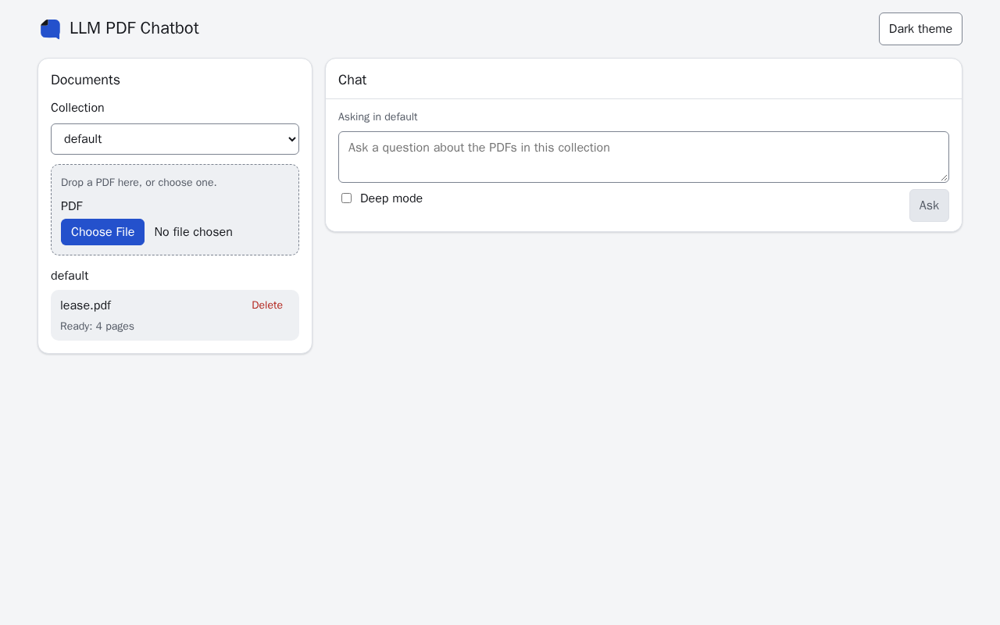
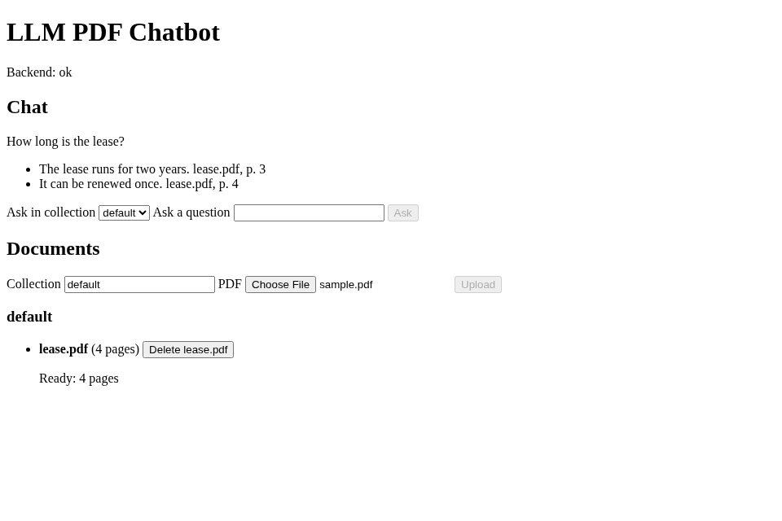
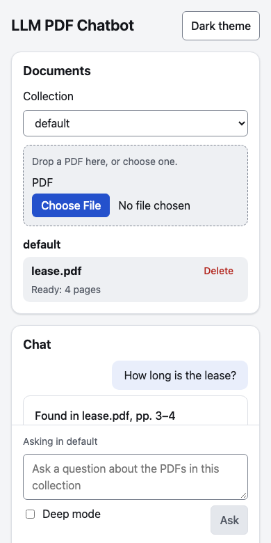

# Using the web app

Open <http://localhost:8080> (`FRONTEND_PORT`) once the stack is up.

## Documents and collections

- The documents panel shows a spinner while it loads the collections.
- One "Collection" picker at the top of the panel sets the active collection: uploads, the sample button and dropped files go into it, and the chat asks in it (the chat shows "Asking in" and its name). "New collection…" in the picker shows a name field; the next upload creates that collection. When the active collection disappears (its last document was deleted), the picker moves to the first collection, or `default`.
- An empty collection left over from before shows a "Remove empty collection" button, which asks first.
- Drop a PDF anywhere on the documents panel to upload it (the panel is highlighted while a file is dragged over it), or choose one with the file button, which uploads it at once. A dropped file that is not a PDF is turned down with a message and nothing is uploaded.
- In the empty documents panel, **Try a sample PDF** uploads a small sample PDF into the active collection.
- Each document shows its file name on one line, cut with an ellipsis when it is long (the whole name is in its tooltip), a small Delete button that asks first, and one status line ("Ready: 3 pages").
- Before any document is uploaded, both the panel and the chat say what to do first: upload a PDF, then ask about it.
- A document still queued or being read shows its progress and a note that it can be asked about once it is ready, and the chat names the documents of the active collection that answers still leave out.
- A failed load or upload shows the reason with a Retry button; Retry upload sends the same file to the same collection again.
- The header says nothing about the backend while it is up; when the health check fails it says "Backend is down".

## Asking

Type a question and press **Ask** (or Enter; Shift+Enter starts a new line). The question is asked in the active collection. The answer streams in under a short line that says where it was found, and every claim carries a citation chip with the page it came from.

- An answer that cites one document names it once, in the line above the claims ("Found in lease.pdf, pp. 1–3", built from the claims, so it never names a page no claim cites). An answer that cites several lists them as numbered sources under the answer, and each chip carries its source's number (`2 · p. 1`). Refusal passages and deep-mode steps use the same short form.
- An answer the documents do not support is shown as "Not in your documents", with the closest passages the search found (file, page and text), or a note that none came close.
- An answer is never left blank: an error from the backend, a request that fails, a stream that ends before its final event and an answer that finishes with nothing in it are each shown as an error, and an answer stopped with the Stop button says it was stopped. If the model cannot be reached, the error says so and names `LLM_BASE_URL` as the setting to check.
- A failed answer has a Retry button that asks the same question again in its place, in the collection and mode it was first asked in.
- A finished answer shows its mode and model, and its cost when the backend could work it out; an unknown cost is left out, never shown as $0.
- Model, quote, passage and file-name text is always shown as plain text, never as markup.

## Deep mode

The "Deep mode" switch beside the question box asks in deep mode (see [How it works](how-it-works.md#deep-mode)). While it is on, a note says before the run that deep mode uses the reasoning model and is slower and can cost more. Each step is listed under the answer as it arrives, in order, with the pages its search found (or "no pages found"), and the steps stay after the answer. When the run is done, its mode and model are shown, with its cost when it is known (no cost is shown when it is `null`, never $0); a run that ends in an error shows the error and no cost.

## Citation viewer

Each claim has a citation chip with its page (`p. 3`). The chip's tooltip is its quote, and its accessible name is the file name and page. Clicking it opens that page of the stored PDF with the quote highlighted; when the quote cannot be found on the page, the page still opens with a "Quote not located on this page." notice and the quote beside it (details in [How it works](how-it-works.md#citation-viewer)). While the page opens, the viewer says so; a PDF that cannot be opened shows the reason with a Retry button.

## Themes and layout

The page follows the system light or dark scheme (`prefers-color-scheme`). The theme button in the header overrides it: it reads "Dark theme" in the light theme and "Light theme" in the dark one. The choice is saved in `localStorage` (key `theme`) and kept on reload. The colours, type sizes, spacing, radii, shadows and focus ring all come from one set of design tokens in `frontend/src/theme.css`, and text passes WCAG AA contrast in both themes.

The page fits 360 px phones to desktops without sideways scrolling: on a desktop the documents panel sits beside the chat; on a phone it stacks above it, the question box stays at the bottom of the screen and the PDF viewer fills the screen.

## Keyboard and screen readers

The page works from the keyboard alone. The first Tab reaches a "Skip to chat" link. The page has a header, a documents sidebar (`aside`) and the chat in `main`. Enter asks the question and Shift+Enter starts a new line. A streamed answer is read out as it arrives (`aria-live="polite"`). A citation opens the viewer with focus inside it. Tab and Shift+Tab stay in the viewer, and Escape closes it and returns focus to the chip. Every control shows the focus ring, and with `prefers-reduced-motion: reduce` nothing animates.

`frontend/e2e/a11y.spec.ts` runs axe over the empty, loaded-chat and viewer-open screens in both themes and fails on any serious or critical violation. It also runs a keyboard-only upload, ask, open and close.
